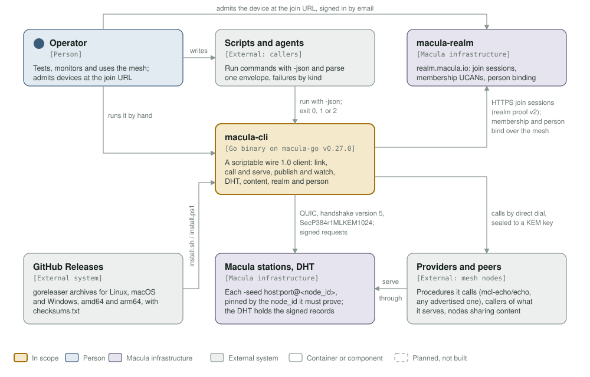
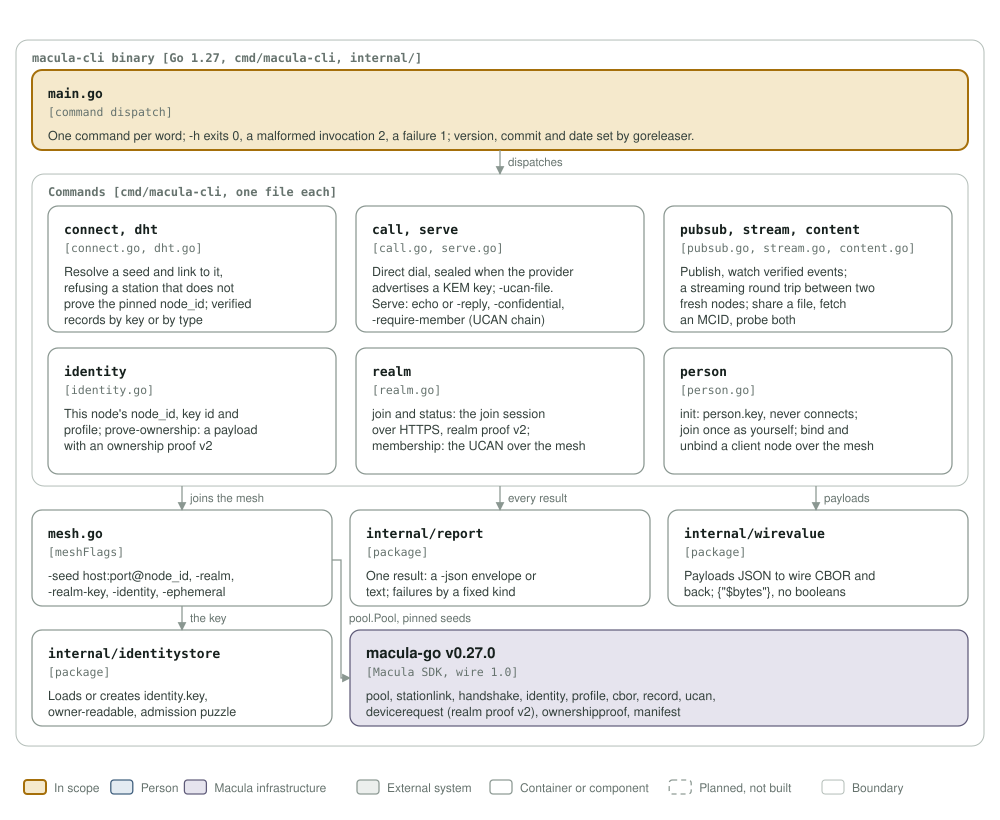

# macula-cli architecture: C4 model

*This exists so a person, a script or an agent can test, monitor and use the Macula mesh from the command line and read exactly what happened.*

**Status: macula-cli 0.16.0** (the latest `v*` tag; the version is set from the tag by `.goreleaser.yml`), on wire 1.0 through macula-go v0.27.0 (`go.mod`). One Go binary, released for Linux, macOS and Windows on amd64 and arm64.

Legend, the same in both diagrams and as in [mcl-fovea](https://github.com/macula-services/mcl-fovea/tree/main/architecture): amber is the element in scope, blue a person, lavender-grey **Macula infrastructure** (the stations and their DHT, macula-realm, the macula SDK), grey-green an external system, white a container or component, a thin solid rounded outline with a muted label a boundary, and dashed boxes are planned, not built (none here).

## Level 1: system context

| Element | Kind | Role |
| --- | --- | --- |
| macula-cli | In scope | A scriptable client of the wire 1.0 mesh: link to stations, call and serve procedures, publish and watch, read the DHT, share and fetch content, join a realm, bind clients to a person |
| Operator | Person | Runs commands by hand or writes the scripts; admits a device, or confirms a person join, at the join URL |
| Scripts and agents | External (callers) | Run commands with `-json` and parse one envelope per result (`pubsub watch`: one per event); failures carry a fixed `kind`; exit 0, 1 or 2 |
| macula-realm | Macula infrastructure | realm.macula.io: join sessions over HTTPS (`/api/v1/join/sessions`, realm proof v2); the membership UCAN and person bind/unbind over the mesh (`<realm>/_realm/_realm/identity/...`) |
| Macula stations, DHT | Macula infrastructure | The stations named by `-seed host:port@<node_id>`, each pinned by the node_id it must prove; QUIC, handshake version 5, SecP384r1MLKEM1024; the DHT's signed records |
| Providers and peers | External (mesh nodes) | Providers it calls by direct dial (`mcl-echo/echo`, any advertised procedure), callers of what it serves, nodes sharing content |
| GitHub Releases | External system | The goreleaser archives and `checksums.txt` that `install.sh` and `install.ps1` download and check |

## Level 3: components of the binary

| Component | Kind | Role |
| --- | --- | --- |
| `main.go` | Command dispatch | One command per word; `-h` exits 0, a malformed invocation 2, a failure 1 |
| `connect`, `dht` | `connect.go`, `dht.go` | Link to a seed, refusing a station that does not prove its pinned node_id; verified DHT records by key or by type |
| `call`, `serve` | `call.go`, `serve.go` | Direct-dial calls, sealed when the provider advertises a KEM key, `-ucan-file`; serving with `-confidential` and `-require-member` |
| `pubsub`, `stream`, `content` | `pubsub.go`, `stream.go`, `content.go` | Publish and watch; a streaming round trip between two fresh nodes; share, get and probe content |
| `identity` | `identity.go` | The node key's node_id, key id and profile; `prove-ownership` (ownership proof v2) |
| `realm` | `realm.go` | `join` and `status` over HTTPS with realm proof v2; `membership` over the mesh |
| `person` | `person.go` | `init` (person key, never connects), `join`, `bind`, `unbind` |
| `mesh.go` | `meshFlags` | The flags every mesh command takes (`-seed`, `-realm`, `-realm-key`, `-identity`, `-ephemeral`); links the node to the seeds |
| `internal/identitystore` | Package | Loads or creates `identity.key` (owner-readable, admission puzzle solved) |
| `internal/report` | Package | Every result as a `-json` envelope or text; failure kinds from macula-go's typed errors |
| `internal/wirevalue` | Package | Payloads between JSON and the wire's CBOR (`{"$bytes": ...}`, no booleans) |
| macula-go v0.27.0 | Macula SDK | `pool`, `stationlink`, `handshake`, `identity`, `profile`, `cbor`, `record`, `ucan`, `devicerequest`, `ownershipproof`, `manifest` |

## Editing the diagrams

Both SVGs in [`../assets/`](../assets/) are generated by [`c4_diagrams.py`](c4_diagrams.py): run `python3 architecture/c4_diagrams.py` from the repository root, render each (`rsvg-convert -w 1400 assets/c4-context.svg -o /tmp/c.png`) and look at it. Colours are plain classes with a `prefers-color-scheme: dark` block, never CSS custom properties, which `rsvg-convert` renders black. Keep this file's tables in step with the diagrams. CI's `c4-model` job fails when either diagram goes missing or stops being shown here.
